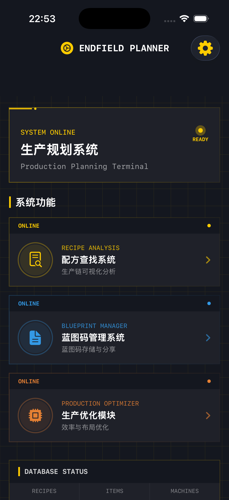
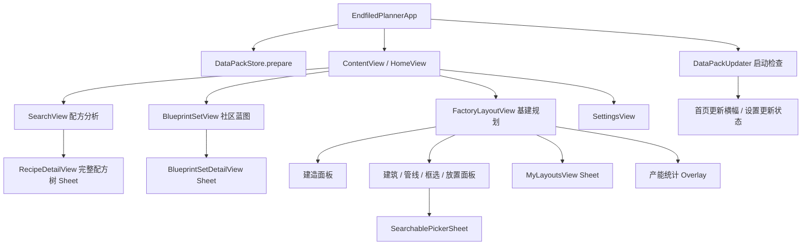

# Endfield Planner · UI/UX 审查与重设计计划

初稿日期：2026-10-19（America/New_York）。当前进度：2026-10-20，用户认可基建反馈修正后，配方分析与社区蓝图两个主页面、完整配方树、蓝图详情及首次说明的视觉改造已实施。

最新导航决定：首页恢复三个功能入口，移除底部栏，统一使用原生导航栈；基建 ViewModel 由导航根持有。详见 [UI_PHASE4_HANDOFF.md](UI_PHASE4_HANDOFF.md) 末尾的最新导航决定。此决定替代前文历史标签导航方案。

最新交接见 [UI_FINAL_PAGES_HANDOFF.md](UI_FINAL_PAGES_HANDOFF.md)。基建工程图 / 等高线反馈见 [UI_BLUEPRINT_STYLE_HANDOFF.md](UI_BLUEPRINT_STYLE_HANDOFF.md)，工作台和导航见 [UI_PHASE4_HANDOFF.md](UI_PHASE4_HANDOFF.md)。按用户要求，本批未构建、运行或测试，最终验收由用户执行。

Phase 3 改动和交接见 [UI_PHASE3_HANDOFF.md](UI_PHASE3_HANDOFF.md)。遵循用户要求，本次没有构建、运行或测试，也没有新增改版后截图；Phase 1 基线验证不能作为本次结果。

**Phase 1 当时只新增文档、参考截图、基线运行截图和构建记录，未修改 Swift 源码。Phase 2 已建立设计系统并接入两个通用组件；业务数据、签名与发布设置保持原样，未提交 Git Commit。**

用户最新要求：完成改动后汇报，不由代理自行测试，交给用户验证。Phase 2 未执行构建、运行、Preview、截图或测试；下文原验收计划改为用户执行，后续同样遵循此要求，除非用户另行授权。实施说明及用户验证入口见 [UI_DESIGN_SYSTEM.md](UI_DESIGN_SYSTEM.md)。

设计案例及三方向对比见 [UI_REFERENCES.md](UI_REFERENCES.md)。推荐采用“工业终端视觉 + 原生 iOS 导航 + 清晰数据排版”。

## 1. 审查范围与基线

### 1.1 仓库与开发约束

- 扫描当前目录和项目邻近目录，未发现 `AGENTS.md`；已阅读 `README.md`、`PLAN.md`、项目 TODO，并检查主要页面、组件、数据加载、计算及持久化入口。
- 旧 `PLAN.md` 包含历史任务的分工、分支与自动提交约定；本任务以用户最新要求为准，不启动这些历史任务、不提交 Commit。后续保持中文 UI 文案及新 Swift 文件的现有作者头注释格式。
- 现有未提交修改：`EndfiledPlanner.xcodeproj/project.pbxproj`、工作区 `UserInterfaceState.xcuserstate`、`EndfiledPlanner/BluePrint/.DS_Store`。本次不覆盖或回退。
- 44 个 Swift 文件，约 12,213 行；391 个物品 imageset，另有 AccentColor、AppIcon、JSON 数据与 Python 生成工具。静态搜索约 296 处固定字号调用、388 处 RGB 颜色构造，表示样式分散程度，不代表有同样数量的独立问题。
- 当前 Deployment Target 为 **iOS 26.0**，Swift language version 5.0，iPhone / iPad；没有第三方 UI 依赖。保持这些兼容要求，不修改 Bundle ID、签名、内购或发布配置。
- 未发现 XCTest / UI Test 源码或独立测试 Target。`Tools` 中有生成与校验脚本，不等同于覆盖 iOS 用户流程的测试套件。

### 1.2 构建、运行及视觉证据

| 验证项 | 本次结果 | 边界 |
|---|---|---|
| 模拟器发现 | 可用 iOS 26.2 iPhone / iPad runtime | 最初沙盒访问失败，使用授权后的外部执行成功 |
| 基线构建 | **BUILD SUCCEEDED** | Debug、iPhone 17 Pro 模拟器目标、关闭代码签名；不是 Release / 真机发布验证 |
| App 启动 | `simctl launch` 成功 | 已安装到该模拟器，未更改源码或注入示例数据 |
| 当前首页截图 | 已取得并实际查看 | 本次唯一完成的当前版本页面运行截图 |
| 其他核心页 | 已检查代码及仓库已有截图 | 未在本次运行中逐页操作，不能称为交互验收通过 |
| 小屏 / iPad / 大字 / VoiceOver | 未运行验证 | 明确列入后续验收 |
| 自动测试 | 未执行 | 未发现现成 iOS 测试 Target；本次为 Phase 1 |

成功构建命令：

```sh
xcodebuild -project EndfiledPlanner.xcodeproj \
  -scheme EndfiledPlanner \
  -destination 'platform=iOS Simulator,id=E79A645D-2524-49E4-BBF5-D4BDFAB0EF6B' \
  -derivedDataPath /tmp/endfield-ui-audit-baseline \
  CODE_SIGNING_ALLOWED=NO build
```

完整记录：[baseline-build.log](ui-audit/baseline-build.log)。早期尝试遇到沙盒和 Preview 宏错误，独立目录的授权重试最终成功；没有为编译删除 Preview 或功能。日志包含现有 `onChange`、`Text + Text`、`UIScreen.main` 弃用警告和部分主 actor 隔离警告，不能将构建成功理解成无警告。



已查看的历史截图：

- [工厂利用率](screenshots/factory_utilization.webp)
- [工厂统计](screenshots/factory_stats.webp)
- [社区蓝图](screenshots/blueprints.webp)
- [配方树](screenshots/recipe_tree.webp)

这些历史图仅用于辅助分析，可能落后于当前代码。例如旧统计图有重复标题，而当前 `FactoryStatsView.showsHeader` 已支持抑制内部标题，不能把旧图中的重复标题列为当前已确认缺陷。浏览器 / Simulator GUI 控制曾长时间无响应，后续通过 `simctl` 完成构建、启动及首页截图，未声称完成全部页面运行检查。

## 2. 当前 UI 架构与导航关系



当前没有 TabView。首页以三个 NavigationLink 进入主要模块，设置在齿轮入口。首页及多个推入页面各自拥有 NavigationStack；真正独立的 Sheet 拥有导航容器合理，但同一 push 链中的重复导航容器会增加返回行为、工具栏样式和状态归属的维护成本，实际故障仍需运行验证。

采用 ObservableObject / Combine 的 MVVM。主要计算在 ViewModel / Model，但视觉层仍包含较多状态映射、字符串格式、搜索历史管理、图片保存与分享逻辑。重构以提取视图和显示适配器为主，不借机替换状态管理框架或改计算层。

### 已存在但未接入主导航的视图

- `ProductionOptimizerView` 是早期“开发中”页面；首页实际直接进入 `FactoryLayoutView`，不是这张占位页。
- `RecipeTreeView` / `NodeView` 是旧递归呈现；`RecipeFlowView` 未找到外部调用。当前搜索预览走 `ThumbnailPreview`，完整图走 `RecipeDetailView` / `DetailNodeView`。
- 不把这些视图列为当前用户可见的核心页面；本阶段不删除。后续可共享样式，但没有必要为非入口视图单独建设新流程。

## 3. 页面、功能、数据与状态清单

### 3.1 工作台 / 当前首页

| 项目 | 当前行为 |
|---|---|
| 用途 | 进入配方分析、社区蓝图、基建规划和设置 |
| 数据 | `RecipeViewModel` 汇总配方关联数、产物数、机器名数；`DataPackUpdater.shared` 更新状态 |
| 操作 | 进入模块；进入设置；在更新横幅启动下载 |
| 状态 | 无更新、可下载、下载进度、待重启；齿轮更新红点 |
| 边界 | 首页配方总数按分组后的数组求和，多产物配方可能重复计数；重设计不擅自改为另一计数口径 |

本次截图确认：导航栏下较大空区、系统横幅、SYSTEM ONLINE / READY、各入口 ONLINE 和英副标题重复占用高度；页面重点应回到“我要查配方 / 找蓝图 / 编辑工厂”。首页统计本身保留，不伪装成个人进度或在线连接状态。

### 3.2 配方搜索与结果预览

| 项目 | 当前行为 |
|---|---|
| 数据 | `DataPackStore` 读 `recipes.json`，`RecipeViewModel` 按产物名分组；ItemCatalog 读物品相态 |
| 搜索 | 前缀匹配优先、包含匹配其次；焦点联想、补全文字、清除、完整物品 Menu |
| 历史 | 最近 8 项；去重前置、删除单项、清空；UserDefaults `recipeSearchHistory` |
| 参数 | 数量 1…100，递增、递减；后续更高效输入也必须保留这个范围 |
| 生成 | 调用现有 `buildTree(target:amount:)`；显示结果总览、预览、进入完整树 |
| 状态 | 未选择 / 输入中 / 已选择 / 生成结果 / 未找到数据；首次免责声明 `recipeDisclaimerSeen` |

业务边界：自动配方选择、避免循环的策略、批次数量向上取整、原料需求与总耗时算法全部保留。总耗时不是把每条支线时间简单相加，UI 不能以重排为由换公式。统计标签只调整表达，不改 `countNodes` 等口径。

### 3.3 完整配方树

用途是理解生产依赖，而不是普通列表。支持双指缩放、拖动、缩放按钮、重置、缩放比例显示、保存相册、分享和关闭。当前图片导出通过 ImageRenderer 和 UIKit，画面与导出分别绘制，容易在改版后产生样式分歧。

节点固定为 160×100；长名称和环境说明存在截断风险，缩小后的字难读。后续保留二维关系及全图浏览，可补充选中节点的可读明细作为辅助，不用线性列表取代树。图片保存目前发起系统写入后直接显示成功文案，没有读取实际完成回调；这是现有反馈准确性风险，后续如果修复需明确作为导出行为修复评估，不在本阶段改动。

### 3.4 社区蓝图列表

| 项目 | 当前行为 |
|---|---|
| 数据 | `BlueprintSetService`：有效缓存 → Gitee → GitHub → Bundle；缓存有效期 1 小时 |
| 内容 | 蓝图集名、作者、地图、地点、说明、蓝图数量 |
| 筛选 | 作者搜索、地图选择；Combine 300ms debounce |
| 刷新 | 顶部刷新，清除缓存再加载 |
| 排序 | 加载后随机展示以兼顾作者曝光；不擅自改成固定推荐或热度排序 |
| 导航 | 卡片点按打开详情 Sheet；iPhone 一列，regular 宽度自适应多列 |
| 状态 | 加载 / 错误重试 / 数据为空 / 筛选无结果 / 内容；首次免责声明 |

不擅自把作者搜索改成标题全局搜索，除非保持原作者搜索并明确增加展示层过滤；不生成不存在的效率、占地等结构化字段。当前这些信息主要在说明文本里。

### 3.5 社区蓝图详情与复制

展示地图与地点、名称、作者、完整说明、按 `order` 排列的各蓝图步骤、代码和 notes；单项复制到系统剪贴板，显示约 1 秒的复制成功状态；当前未见触觉反馈实现。关闭后返回原列表。

后续将步骤编号、名称、注意事项与复制操作放在同一区域；复制必须保留原始代码，不能将视觉截断、省略号或空白清理写回剪贴板。作者与版权说明不能隐藏。

### 3.6 基建规划：画布与工具

| 功能组 | 必须保留的操作和状态 |
|---|---|
| 地图 | 四号谷地 / 武陵；80×80 网格；地图切换会清空当前布局，确认与可撤销语义保留 |
| 画布 | 双向滚动；格尺寸 16…120，初始 72；双指缩放；端口、方向、仓库边界、供电范围和冲突显示 |
| 建造 | 按分类筛选、建筑选择；长按 0.2 秒后拖入画布；放置前旋转；地图不可用设施按现有规则过滤 |
| 单选 | 建筑 / 管线互斥选择；空白取消；部分非选择工具中仍可点已有对象查看 |
| 线路 | 传送带 / 管道 L 形绘制、预览、吸附、交叉物流桥；地图限制仍从 MapRules 来 |
| 编辑 | 移动、旋转、收纳、建筑连线重接；重接失败提示；协议核心不可删除 |
| 删除 | 删除工具滑动连续删除；建筑收纳；管线删一格 / 整条，整条确认保留 |
| 历史 | 撤销 / 重做；上限 60；同次手势合并为一步，不因 UI 事件重复触发而拆散 |
| 框选 | 选择建筑及线、数量反馈、整组移动 / 删除、边缘自动滚动；协议核心排除规则保留 |
| 持久化 | 菜单保存画布、成功提示；重开读取存档；现有存档迁移和配方 ID 保留 |
| 预设 | 两套现有产线；加载确认，不新造预设数据 |
| 诊断 | 电力不足 / 未通电提示、状态点、地图冲突；线路利用率开关、百分比与图例 |
| 统计 | 浮动入口、统计覆盖层、滚动、关闭；不丢失画布当前编辑上下文 |

关键状态：`editMode`、`selectedBuildingID`、`selectedBeltID`、`pendingPlacement`、框选、拖放、待确认地图 / 预设、告警、保存提示。`editMode.didSet` 会清理选择或待放置组；新工具 UI 必须调用既有方法，不能随意重复赋值，避免取消用户正在放置的布局。

### 3.7 建筑检查面板

手机是**内嵌底部非模态面板**，iPad 是右侧浮层；并非普通模态 Sheet，改版后必须保持展开时仍可操作画布。

通用信息：设施名、耗电或发电、运行状态、实际运行率、原因、开关、移动、取消移动、旋转、收纳、关闭面板、手机展开 / 折叠。

类型专属内容必须逐项保留：

| 类型 / 能力 | 现有内容 |
|---|---|
| 普通生产设备 | 搜索选择配方、模式限制、需求与到货、实际产出 |
| 反应池 / 扩容反应池 | 多选配方、自我供给、物料槽与输出分配 |
| 转化机 / 气体散布机 | 激活材料、到货、运行率、环境相关说明 |
| 准入口 | 限速控制、只放行物品、清空过滤选择 |
| 取货口 / 暗管 | 物料选择、相关吞吐与地图说明 |
| 协议核心 | 各出货端口独立选择、固定发电、入库内容 |
| 热能池 | 燃料选择、相关消耗和发电展示 |
| 供电设施 | 覆盖范围与供电说明 |
| 存货口 / 处理设施 | 实际终点消耗 |
| 地图不兼容 | 原因与不参与统计提示 |

当前移动提示还写着“原来接的线不会跟着走”，与现有重接逻辑及线路断开提示不一致。后续可修正文案，但不能顺带改路由算法。

### 3.8 管线详情、选择器、组操作与我的布局

- **管线详情**：类型、长度、速度 / 上限、实际物品与流量、状态；整条高亮；删除一格 / 整条；展开折叠与关闭。
- **SearchablePickerSheet**：标题 / 副标题搜索、物品图标、原料筛选标签、单选后关闭、多选保留至“完成”、清空选择、禁用标签；已选的不合法项仍允许取消勾选。UI 重构不能把它变成只能看见合法项的简化列表。
- **GroupSelectionPanel**：数量、整组移动 / 删除、存为布局、取消选择，以及空选区状态。
- **MyLayoutsView**：本地布局缩略图、名称、来源地图、大小 / 建筑数、使用、改名、删除确认、空列表、关闭。
- **PlacementPanel**：待放布局名、能否放置及阻挡原因、整体旋转、确认、取消。跨地图放置提示已有冲突清单，不自动强制转换布局。

### 3.9 产能统计

当前 `ProductionStats` / `FlowSimulator.Result` 是唯一数据来源。所有信息继续可访问：建筑数、发电、耗电、电力余量、产线数、瓶颈、直通节点、仓库物料、电力明细、未通电、未收敛、异常机器、终点消耗、建筑分类、各生产线及实际 / 理论速率。

后续组织为“摘要 → 异常原因 → 产出与消耗明细 → 分类分布”。可以分区折叠，但不可默认隐藏关键告警；正常机器不必复制到异常区。没有时序数据，不能添加伪造趋势图。

### 3.10 设置、更新与免责声明

- 设置现有入口包括网格背景、自动保存、版本、GitHub、数据版本、检查更新 / 下载、恢复内置、清除缓存。
- `showGrid`、`autoSave` 只在 SettingsView 发现读写；其他视图没有消费这些键。`darkMode` 声明但未发现控件或全局应用。GitHub 与 Clear Cache 按钮的 action 仍是注释。**这些是现有未实现 / 未接线行为，不是已正常工作的功能。**
- 不删除上述入口、不篡改旧设置值；也不把它们在改版报告中写成“已验证可用”。是否补接行为、缓存清理的准确范围、自动保存时机，应单独确认后实现，避免破坏当前存档规则。
- 更新器状态完整保留：idle / checking / upToDate / available / needsAppUpdate / downloading / readyToRestart / failed。下载经过大小与 SHA256 校验，暂存 pending，重启后启用；恢复内置也是按现有机制生效，UI 不提供“立即切换成功”的假反馈。
- 配方与蓝图首次确认后不再提示；基建默认每次进入提示一次，选“不再提示”后关闭（`optimizerDisclaimerHidden`）。保留这些不同规则及原持久化标记；可统一视觉和无障碍焦点，不合并为一个新的同意标记。

## 4. 数据与业务保护边界

| 数据 / 服务 | 位置与用途 | 改版要求 |
|---|---|---|
| 配方 / 物品 / 设施 / 燃料 | `recipes.json`、`items.json`、`devices.json`、`fuels.json` | 不改内容、ID、相态与解析规则 |
| 配方树 | RecipeViewModel + Recipe / RecipeNode | 不改选配方、循环截断、批次和耗时 |
| 布局与模拟 | FactoryViewModel / FactoryGridModel / FlowSimulator / MapRules | 不改坐标、路线、流量、电力、地图规则和统计口径 |
| 主画布存档 | UserDefaults `factory_layout_v1`，`FactoryLayout.dataVersion = 2` | 维持解码兼容与旧配方下标迁移；不重新命名键 |
| 我的布局 | Application Support `my_layouts.json` | 维持 Codable 结构、UUID、相对坐标、建筑与线路设置 |
| 蓝图 | BlueprintSetService + `blueprints.json` | 保留双镜像、Bundle 回退、缓存、作者曝光策略和复制内容 |
| 数据包 | Application Support `DataPack/active`、`pending`、`staging`、reset | 保留启动原子切换与按文件回退；不让主题刷新触发 prepare |
| 历史 / 设置 / 同意 | UserDefaults / AppStorage | 保留原键、原值，不因导航更换重置 |
| 图标 | ItemIcon、ItemIcons.xcassets、icon_fallbacks，下载图标优先 | 保留完整查找与回退；装饰图标继续避免重复 VoiceOver 播报 |

`FactoryBuilding.swift` 含分类颜色 / SF Symbol，业务定义与样式有耦合。后续优先在 View 侧提供显示映射，并保留分类枚举与现有行为；不为移走颜色大改设备模型。

## 5. 主要 UI/UX 问题与优先级

证据类型：**运行** = 本次实际截图；**代码** = 静态确认；**历史图** = 仓库截图，只作为辅助。

| 优先级 | 问题 / 证据 | 影响 | 建议 |
|---|---|---|---|
| P1 | 工具栏 8 个工具，武陵加管道为 9 个；8pt 标签、52pt 固定高度（代码 / 历史图） | 375pt 屏宽九等分不足 42pt，标签与触控区域受限 | 模式工具与文档动作分开，工具保持可见；窄屏两排 / 自适应布局，不靠缩字 |
| P1 | 固定字号、固定高度 / 宽度集中；详情和节点小字很多（代码） | Dynamic Type 难以生效，长中文及大字可能溢出 | 语义字体、最小高度、纵向重排，图节点与可读检查面板配合 |
| P1 | `showGrid` / `autoSave` 未被消费，缓存与链接 action 未实现（代码） | 设置承诺与实际行为不一致 | 记录为独立功能缺口，确认后补接，不用视觉改版掩盖 |
| P1 | 多个自定义卡片依赖 onTapGesture，图标按钮缺少完整语义标签（代码） | VoiceOver 难以发现操作 / 选择状态 | 用 Button / NavigationLink，补 label、value、selected trait 与焦点顺序 |
| P2 | 首页重复横幅、恒定 ONLINE、英文标签与大间距（运行） | 首屏工作入口不够集中，像功能展示页 | 紧凑工作台，入口直接表达用途，统计与更新真实状态保留 |
| P2 | 全页细网格、彩色边框和高饱和彩字普遍存在（运行 / 代码） | 装饰与数据争夺注意力，异常色不突出 | 普通页面移除装饰网格，中性表面、单一主强调，状态色只服务含义 |
| P2 | 多处白色 0.3 / 0.4 透明度及 9–11pt 标签（代码 / 历史图） | 小字号低对比风险；未做自动对比度测量 | 独立文字 Token，普通 / 增强对比度分别验收 |
| P2 | 蓝图筛选栏与横幅较长、完整物品用超长 Menu（代码 / 历史图） | 用户滚动和查找成本高 | 轻量标题、地图快捷筛选；复用可搜索选择器 |
| P2 | 状态、类别、动作都用许多不同颜色（代码 / 历史图） | 相同颜色含义不稳定 | 建立状态 / 分类 / 操作三个明确语义域，保留线路区别 |
| P2 | 固定 360 / 380pt 侧面板与 overlay 叠加（代码） | regular size class 不保证实际宽度足够，横屏 / 分屏可能遮挡 | 使用可用宽度决策，受控面板优先级与滚动 |
| P2 | 多个 push 层各建 NavigationStack（代码） | 导航和状态归属复杂 | 阶段化统一 AppShell，每个模块一个稳定根状态，模态单独导航 |
| P2 | 保存图片直接报告成功、截图渲染依赖 UIScreen.main（代码） | 权限失败反馈和 iPad / 多窗口导出存在风险 | 单独核实导出回调，复用显示内容，不顺带改导出范围 |
| P3 | 网格背景、横幅、按钮和样式复制（代码） | 跨页维护成本高 | 设计 Token + 专用组件；不把所有业务面板抽成巨型万能组件 |
| P3 | 现有动画未见 Reduce Motion 分支（代码） | 无障碍偏好未系统覆盖 | 仅面板变化和成功反馈动画，遵循系统偏好 |

## 6. 推荐的信息架构

建议确认后逐步建立四个平级工作区：**工作台 / 配方 / 蓝图 / 基建**，设置从工作台齿轮进入。

- 工作台保留所有原入口、数据库统计、更新提醒；不新增无数据支持的“今日进度”或最近记录。
- 配方聚焦“目标 + 数量 + 依赖结果”，不再用大横幅开场。
- 蓝图是社区代码资料库；“我的布局”继续明确是本地可放置建筑组，不能与社区蓝图混为一谈。
- 基建是长期编辑工作区；导航切换不能丢掉未保存的内存布局、撤销栈、当前选择与缩放。
- iPad 可用原生侧栏 / 自适应导航，但依据实际宽度决定检查面板。不要只按设备型号判断。

Phase 3 先沿用当前 push 入口，**不同时更换 App 级导航**。全局导航留到代表页视觉确认后，单独验证 VM 所有权与页面状态恢复。

## 7. Design System 草案（确认后才建代码）

### 7.1 Color Tokens

以下为 A 方向深色候选值，不是已验证的最终色。以语义命名，在 `DesignSystem` 中集中管理，普通 View 不直接写 RGB。

| Token | 候选 | 使用 |
|---|---|---|
| background.canvas | `#0D1116` | 工厂 / 配方关系图底 |
| background.app | `#101318` | 页面背景 |
| surface.primary | `#1A2028` | 内容模块 |
| surface.elevated | `#242D38` | 属性检查器 / 浮层 |
| text.primary | `#F2F4F7` | 标题、正文 |
| text.secondary | `#B7C1CD` | 说明、单位 |
| text.tertiary | `#8B98A8` | 非关键辅助信息；仍须测对比度 |
| border.subtle | `#34404D` | 轻分隔；关键输入边界另作增强对比度版本 |
| accent.primary | `#F2CD45` | 主操作、选中；实底按钮用深色文字 |
| status.success | `#73C69A` | 生产中 / 成功 |
| status.warning | `#EFB15D` | 原料不足 / 警告 |
| status.error | `#F27D7D` | 阻塞、冲突、失败、危险动作 |
| status.info | `#80B7ED` | 说明 / 选项提示 |

透明度不能代替文字颜色层级。分类色与线路色单独设语义 Token，不擅自调换固体 / 管道 / 满载 / 限流的含义。状态必须同时有文字或符号。浅色支持通过同名 Token 对应系统动态颜色实现；深色先验收，但不把浅色适配变成白底白字。

默认尊重系统外观；“深色优先”指设计与验收顺序。现有未启用的 `darkMode` 键不改写为新的枚举或迁移规则。若要强制全局深色，应作为明确产品选择确认，而不是顺手启用旧布尔值。

### 7.2 Typography

| 角色 | SwiftUI 原则 | 用途 |
|---|---|---|
| 页面标题 | `.title2.weight(.bold)`，必要时 `.largeTitle` | 避免每页重复大横幅 |
| 分组标题 | `.headline` | 面板 / 明细标题 |
| 正文 | `.body` | 蓝图说明、告警原因 |
| 行标签 | `.subheadline` | 信息密度与阅读平衡 |
| 单位 / 辅助 | `.footnote` / `.caption` | 不承担核心操作名 |
| 指标 | `.title2` 或 `.headline` + `.monospacedDigit()` | 数值对齐，不把中文正文全部等宽 |
| 代码 / 坐标 | 相对语义字号的 monospaced | 蓝图码、网格坐标 |

大字时改布局，不用 `.minimumScaleFactor` 把核心文字压小。图表 / 画布坐标仍是业务空间，文字可通过检查面板提供未缩放的阅读入口；不能任意改变节点位置公式或网格尺寸规则。

### 7.3 Spacing、尺寸与边界

- 间距阶梯：4 / 8 / 12 / 16 / 20 / 24 / 32；16 为普通页面边距，iPad 随可用宽度调整。
- 常规行最小高度 48–56pt，文字可自然增高；主要触控目标至少 44×44pt。
- 角半径：8（小控件）、12（模块）、16（检查面板）；Sheet 采用系统表现，网格建筑保留几何形状。
- 边框普通 1pt、选中 / 高对比度加粗；不给所有卡片加渐变与光晕。
- 使用 safeAreaInset / 容器布局保证工具与画布不互相遮挡；设计底部工具区时预留面板高度和键盘空间。

### 7.4 通用组件与责任

| 建议组件 | 责任 | 不承载 |
|---|---|---|
| AppTheme / AppTypography / AppSpacing | Token 与系统偏好映射 | 数据源、单例业务状态 |
| AppPageHeader / SectionHeader | 中文标题、可选说明与操作 | 恒定假在线标识 |
| Surface / MetricCell / KeyValueRow | 表面、指标、名称值对齐 | 数值计算和统计汇总 |
| PrimaryAction / SecondaryAction / ToolButton | 层级、禁用态、触控与 VoiceOver | 业务确认规则 |
| StatusBadge / InlineNotice | 状态、图标、原因、无障碍播报 | 按颜色重新推断机器状态 |
| SearchField / FilterChip / SelectionRow | 搜索与选择视觉 | 替换已有过滤规则 |
| InspectorContainer | 底部 / 侧边布局、滚动、折叠、关闭 | 建筑类型判断、模拟逻辑 |
| EmptyState / LoadingState / ErrorState | 说明、进度、重试操作 | 自动伪造数据或吞掉错误 |
| FeedbackToast | 保存 / 复制短反馈 | 将发起请求当作已成功 |

保留系统 Menu、Alert、ConfirmationDialog、ShareSheet。免责声明可统一为易滚动的呈现样式，但分别绑定原来的同意标记与原文。

### 7.5 导航、交互与动画规范

- 主导航中文短名，页面标题与主操作可见；单个 push 层不重复创建无必要导航栈。
- 加载进度来自现有状态；空数据与筛选无结果区分；错误保留原因与重试；待重启始终如实说明。
- 删除整条线路、清空、切图、加载覆盖、删除本地布局等保留各自现有确认语义，避免过度统一。
- 保存 / 复制保留短时文字反馈，可适当增加轻触觉；VoiceOver 不连续播报每一帧流量。
- 选择和面板变化约 0.18–0.25 秒；面板可用轻微 spring。Reduce Motion 下以直接更新或短淡入为主；不让数值每次重算都跳动，不加装饰扫描线。
- 输入合法性只做已有边界的显示，不改变数量、限速、地图或配方限制。

## 8. 逐页重设计蓝图

| 页面 | 新的信息层级 / 操作 | 复用与适配 |
|---|---|---|
| 工作台 | 中文产品名 → 三个紧凑任务入口 → 真实更新状态 → 数据库指标 | 不靠 ONLINE 条制造层级；大字纵排；统计口径保留 |
| 配方 | 目标搜索 → 数量 → 生成 → 总耗时 / 节点数 → 图预览 | 复用可搜索选择器替换超长 Menu；历史删除 / 清空保持可达 |
| 完整树 | 目标 / 数量 → 最大画布 → 聚合缩放控制 → 节点详情入口 → 导出 | 保留图、拖动、缩放、重置、保存、分享；长名在明细完整阅读 |
| 蓝图列表 | 标题 / 刷新 → 作者搜索 → 地图筛选 → 结果 → 紧凑方案行 | 名称优先，作者 / 地点 / 数量其次；详情完整说明；可点行用原生语义 |
| 蓝图详情 | 名称、地图、作者 → 完整说明 → 按顺序的代码与 notes | 复制按钮紧邻代码，触控足够大，成功态局部反馈，不改排序 |
| 工厂 | 地图 / 保存与撤销 → 主画布 → 模式工具 → 非模态属性面板 | 工具不塞入九等分一行，地图与删除状态持续可见 |
| 建筑属性 | 名称 / 状态原因 → 到货 / 实际产出 → 配置 → 编辑动作 | 按设施类型保留全部字段；手机折叠 / 侧面板自适应 |
| 管线属性 | 类型 / 状态 → 物品与流量 / 上限 / 长度 → 删除 | 局部与整条删除明确，色彩不成为唯一状态线索 |
| 产能统计 | 摘要 → 电力 / 未收敛 / 异常 → 产出消耗 → 分类 | 紧凑对齐行、单位一致、大字改上下；没有数据就不画趋势 |
| 我的布局 | 名称 / 缩略图 / 来源 → 使用 → 改名 / 删除 | 空状态解释“先框选后保存”；跨地图确认继续存在 |
| 设置 / 更新 | 显示 → 数据版本 / 进度 → 恢复 → 关于 / 数据管理 | 原生分组列表；保留设置值；未接线项行为单独决策 |
| 免责声明 | 用途 / 限制 / 作者版权 → 可滚动原文 → 确认 | 标题与按钮可读、焦点进入弹层，逐模块原标记不变 |

## 9. 文件修改范围与复用判断

### 9.1 Phase 2 预计新增

目录建议 `EndfiledPlanner/DesignSystem/`：

- `AppTheme.swift`：颜色、字、间距、圆角、系统偏好。
- `Components/Surface.swift`、`ActionStyles.swift`、`PageHeader.swift`。
- `Components/StatusViews.swift`、`MetricViews.swift`、`InspectorContainer.swift`。
- 可按实际使用合并小文件，避免空壳组件；保留既有调用端逐步接入，不全项目一次替换。

### 9.2 现有文件的处理

| 文件 / 组 | 处理与风险 |
|---|---|
| `other/ContentView.swift` | 重组 HomeView，替换页面私有横幅、功能卡片和统计外观；之后再引入 AppShell |
| `other/SettingsView.swift` | 统一原生列表、状态与文案；不擅自补改存档策略 |
| `DataPack/DataUpdateBanner.swift` | 接设计系统，保持 updater 状态绑定 |
| `RecipeSearch/View/SearchView.swift` | 拆控制区、历史、结果；SearchHistoryManager 可原样移文件，不改键或规则 |
| `RecipeDetailView.swift` | 统一树节点、控制与导出外观；显示 / 导出共用视觉组件，保留行为 |
| `RecipeFlowView.swift`、`RecipeTreeView.swift`、`NodeView.swift` | 非核心入口，最后检查样式共享，暂不删除 |
| `BluePrint/View/BlueprintSetView.swift` | 重组搜索、筛选、内容状态，不改 VM 顺序 |
| `BlueprintSetCard.swift`、`BlueprintSetDetailView.swift` | 紧凑行、步骤与复制；保留作者 / 说明 |
| `BlueprintDisclaimerView.swift` | 与其他免责声明共享视觉容器，保留全文与标记 |
| `FactoryLayoutView.swift` | 先提取工具与面板布局；保留 alerts modifier、手势挂载和滚动坐标链 |
| `FactoryGridView.swift` | 第一轮只改绘制样式、选中态与无障碍，避免改命中、L 路由和手势优先级 |
| `BuildingDetailPanel.swift`、`BeltDetailPanel.swift` | 复用非模态 InspectorContainer，保留所有操作回调 |
| `FactoryStatsView.swift` | 重组摘要 / 告警 / 明细，不改 ProductionStats |
| `GroupSelectionPanel.swift`、`PlacementPanel.swift` | 统一动作与阻挡原因，保留组操作流程 |
| `MyLayoutsView.swift` | 缩略图数据与存储原样，重组列表与动作 |
| `SearchablePickerSheet.swift` | 优先复用；适配主题、语义字号、大字及选择无障碍 |
| `ItemIcon.swift` | 保留查找逻辑与 accessibilityHidden，仅按组件需要调整视觉容器 |
| `OptimizerDisclaimer.swift` | 接统一免责声明容器，保留确认逻辑 |
| `ProductionOptimizerView.swift` | 历史占位页不进入新导航，本次不删除 |

**默认不修改** RecipeViewModel、BlueprintSetViewModel / Service、FactoryViewModel 及扩展、FactoryGridModel、FlowSimulator、MapRules、数据包服务、JSON、图集、生成脚本和项目发布配置。若仅为状态所有权需调整 View 中的 VM 注入，先做独立差异审查，保证实例生命周期稳定。

### 9.3 已有可复用 / 需要重构的分界

- 直接保留能力：ItemIcon、SearchablePickerSheet 的 API、LayoutThumbnail、所有 ViewModel / Store、数据更新状态机、已有确认弹窗逻辑。
- 保留功能但改结构：建筑 / 管线 / 组 / 放置面板、统计、蓝图行、搜索历史与数量区、配方节点。
- 统一替换视觉壳：重复网格装饰、横幅、状态点样式、局部按钮、固定字号指标盒。
- 不抽象：不同设备的专用配置内容，不强行做一个承载全部分支的“通用卡片”。

## 10. 实施顺序与确认关口

### Phase 1（当前）

完成参考研究、当前功能盘点、风险与方案；交付本文与 UI_REFERENCES。**到这里停止，等待用户确认方向。**

### Phase 2（确认后）

先建 Token、按钮、数据行、状态与非模态面板容器；小范围接入，构建验证。只设计已有状态，不创建新业务状态机。组件预览覆盖长名、禁用、错误、缺省、大字。

### Phase 3（代表页）

选择 **基建规划**，分三步保持可核查：

1. 先重组工具栏、地图 / 文档入口、画布边界；保留入口路径与 VM。
2. 再改建筑 / 管线检查器与建造面板；全部类型内容逐项对照。
3. 改统计摘要与告警外观，检查整体画布密度和面板遮挡。

完成后构建、运行、获取实际 iPhone 截图；可用时补 iPad 和小屏 / 大字。确认选择、摆放、配方、线路、保存、撤销、统计仍可访问。提交视觉结果供用户确认，**未确认不批量扩散到其他页面**。

### Phase 4（逐页）

推荐顺序：工作台与导航 → 配方搜索 / 完整树 → 社区蓝图列表 / 详情 → 我的布局与辅助面板 → 设置 / 更新 / 免责声明 → 非主入口样式检查。

每页保留改动边界，编译后验证导航、绑定、空态、长文及可用操作，再进入下一页；没有新失败或风险不反复跑无关测试。

### Phase 5（完成全部页面后）

- 完整构建、现有可适用验证脚本；若届时仍无测试 Target，如实记录，不声称测试套件通过。
- 双地图预设、存档重开、旧存档迁移、我的布局、复制与导出、更新各状态。
- 常规手机、小屏手机、iPad 横竖屏 / 分屏；普通字号和最大无障碍字号。
- 深色、系统浅色、增强对比度、Reduce Motion、VoiceOver。
- 产能与业务数值与改版前固定样本一致；列出修改文件及人工剩余项。
- 用户未要求时不提交 Commit。

## 11. 风险及具体验收清单

| 风险 | 防护与验收 |
|---|---|
| 导航更改重建 ViewModel | 稳定根状态所有权；切换模块后布局、选择、历史栈不意外重置 |
| 工具 / 面板重排影响坐标 | 不动手势、coordinateSpace、scrollGeometry、长按 recognizer；拖拽、边缘滚动逐项实测 |
| 建造与删除回调重复 | 同一动作只调用一次既有 VM 方法；撤销一步对应用户一次操作 |
| 弹层抢占画布触控 | 建筑 / 管线面板保持非模态；只有选择器等独立任务使用 Sheet |
| 小屏工具不可见 | 375pt 宽检查九工具；两排或受控重排，全部操作可达且不缩字 |
| 大字导致面板占满 | 面板有滚动、折叠及可达关闭；数字 / 标签转纵排；不裁掉关键配置 |
| 分类色与状态色混淆 | 文字 / 图标冗余，固定语义，利用率模式与选中边界可区分 |
| 存档 / 数据包损坏 | 不改 Codable、UserDefaults 键、路径或启动顺序；实际保存重开比对 |
| 导出样式漂移 | 显示与导出共用内容样式；单独核实相册权限 / 失败反馈与 iPad 分享 |
| 远程内容不稳定 | 使用现有 Bundle 与镜像回退；不把网络失败伪装为空数据；离线实测 |
| 设置缺口影响范围 | 未接线项独立记录，不在设计重构中偷偷启用或改存档时机 |

后续人工流程矩阵：

| 流程 | 最低验收 |
|---|---|
| 配方 | 输入 / 联想 / 全部物品 / 8项历史 / 单删清空 / 数量边界 / 生成 / 长链 / 循环原行为 |
| 图 | 缩放 / 拖动 / 重置 / 长名称 / 保存权限允许与拒绝 / 分享取消 / iPad 弹出定位 |
| 蓝图 | 作者 / 地图组合过滤 / 刷新 / 无网回退 / 空态 / 原序步骤 / 原始码复制 / 作者说明 |
| 画布 | 双地图 / 所有工具 / L形线 / 桥 / 建造拖拽 / 移动旋转连线 / 框选边滚 / 删除 / 撤销重做 |
| 属性 | 普通 / 多配方 / 激活 / 过滤限速 / 燃料 / 供电 / 核心各口 / 暗管 / 不兼容禁用与取消 |
| 布局 | 手动保存重开 / 原有数据 / 旧存档 / 存组 / 改名 / 删除 / 整体旋转放置 / 跨地图冲突 |
| 统计 | 电力 / 到货 / 产出 / 消耗 / 瓶颈 / 未通电 / 未收敛 / 利用率图例，与基线数值一致 |
| 更新 | 无更新 / 可用 / 下载中 / 失败重试 / 格式过新 / 待重启 / 重启启用 / 恢复内置 |
| 无障碍 | 按钮有名字和状态；焦点顺序；关闭可达；状态非仅颜色；动态大字无裁切 |

以上矩阵尚未执行完毕，不能作为通过记录。Phase 1 只确认了构建与首页运行截图。

## 12. Phase 1 当时的确认事项（已获准进入 Phase 2）

1. 是否采用推荐组合：**A 工业终端为主，B 原生导航和控件，C 数据排版**；另外两套完整方向见参考文档。
2. 是否同意先用 **基建规划** 验证整体视觉，然后停下来确认截图。
3. 四个平级工作区的导航建议是否接受；具体导航改动排在代表页确认之后。

未接线设置与导出反馈风险已有记录，不默认授权更改业务行为。Phase 2 说明见 UI_DESIGN_SYSTEM；Phase 3 交接见 UI_PHASE3_HANDOFF；用户已授权面板溢出修正与下一阶段一起推进，Phase 4 第一批交接见 UI_PHASE4_HANDOFF。

## 附录 A · Swift 文件完整索引
路径相对于 `EndfiledPlanner/`；目录名不一定反映职责，例如 `ViewModel` 目录也包含 Codable 模型、Store、规则和模拟器。

### App 入口与设置

- `other/EndfiledPlannerApp.swift`
- `other/ContentView.swift`
- `other/SettingsView.swift`

### 配方视图

- `RecipeSearch/View/NodeView.swift`
- `RecipeSearch/View/RecipeDetailView.swift`
- `RecipeSearch/View/RecipeFlowView.swift`
- `RecipeSearch/View/RecipeTreeView.swift`
- `RecipeSearch/View/SearchView.swift`

### 配方模型与 ViewModel

- `RecipeSearch/Model/ItemCatalog.swift`
- `RecipeSearch/Model/Recipe.swift`
- `RecipeSearch/Model/RecipeNode.swift`
- `RecipeSearch/ViewModel/RecipeViewModel.swift`

### 蓝图视图

- `BluePrint/View/BlueprintDisclaimerView.swift`
- `BluePrint/View/BlueprintSetCard.swift`
- `BluePrint/View/BlueprintSetDetailView.swift`
- `BluePrint/View/BlueprintSetView.swift`

### 蓝图模型、ViewModel 与 Service

- `BluePrint/ViewModel/BlueprintModels.swift`
- `BluePrint/ViewModel/BlueprintSetService.swift`
- `BluePrint/ViewModel/BlueprintSetViewModel.swift`

### 基建视图与组件

- `ProductionOptimizer/ProductionOptimizerView.swift`
- `ProductionOptimizer/View/BeltDetailPanel.swift`
- `ProductionOptimizer/View/BuildingDetailPanel.swift`
- `ProductionOptimizer/View/FactoryGridView.swift`
- `ProductionOptimizer/View/FactoryLayoutView.swift`
- `ProductionOptimizer/View/FactoryStatsView.swift`
- `ProductionOptimizer/View/GroupSelectionPanel.swift`
- `ProductionOptimizer/View/ItemIcon.swift`
- `ProductionOptimizer/View/MyLayoutsView.swift`
- `ProductionOptimizer/View/OptimizerDisclaimer.swift`
- `ProductionOptimizer/View/PlacementPanel.swift`
- `ProductionOptimizer/View/SearchablePickerSheet.swift`

### 基建模型、模拟器、Store 与 ViewModel

- `ProductionOptimizer/ViewModel/BuildingParser.swift`
- `ProductionOptimizer/ViewModel/FactoryBuilding.swift`
- `ProductionOptimizer/ViewModel/FactoryGridModel.swift`
- `ProductionOptimizer/ViewModel/FactoryPreset.swift`
- `ProductionOptimizer/ViewModel/FactoryViewModel+Group.swift`
- `ProductionOptimizer/ViewModel/FactoryViewModel+Placement.swift`
- `ProductionOptimizer/ViewModel/FactoryViewModel.swift`
- `ProductionOptimizer/ViewModel/FlowSimulator.swift`
- `ProductionOptimizer/ViewModel/MapRules.swift`
- `ProductionOptimizer/ViewModel/MyLayouts.swift`

### 数据包服务与 UI

- `DataPack/DataPackStore.swift`
- `DataPack/DataPackUpdater.swift`
- `DataPack/DataUpdateBanner.swift`

资源索引：`other/Assets.xcassets`（主题色 / AppIcon）、`other/ItemIcons.xcassets`（物品图标）、`other/*.json`（数据包清单 / 元信息 / 配方 / 物品 / 燃料 / 设施 / 旧配方索引 / 预设 / 图标回退）、`BluePrint/blueprints.json`（社区蓝图）、根目录 `素材原图/`（生成素材）、`Tools/`（数据 / 图标 / 预设 / 清单生成与蓝图导入）。本次没有变更这些资源。
